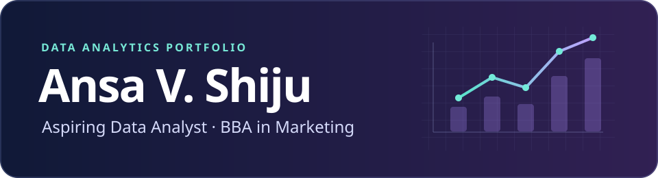

## Featured project · Online Retail II

| Revenue | Orders | Customers | Average order value |
| ---: | ---: | ---: | ---: |
| **£16.96M** | **36,457** | **5,860** | **£465.12** |

I used **Excel and Power Query** to clean retail transactions and built a dashboard to compare sales by month, product, customer, and country.

> [!TIP]
> November was the highest-revenue month in both 2010 and 2011. I recommended planning stock and staffing before the holiday sales period.

[Download the Excel preview](https://raw.githubusercontent.com/ansavshiju/Excel-Projects/main/Online-Retail-II/Online_Retail_II_Preview.xlsx) · [Explore findings and recommendations](https://github.com/ansavshiju/Excel-Projects/tree/main/Online-Retail-II#findings-and-recommendations)

---

## Explore my work

### [Excel Projects](https://github.com/ansavshiju/Excel-Projects)

Retail Sales and Sales Data workbooks, plus the Online Retail II dashboard and detailed case study.

### [Python Notebooks](https://github.com/ansavshiju/Python)

Jupyter notebooks from my Python practice, including exercises on strings, lists, dictionaries, and sets.

### [Data Analytics Coursework](https://github.com/ansavshiju/Data-Analytics-overview)

Course notes and an employee dataset analysis with documented findings.

---

## About me

I’m training in data analytics at **Route Upskill Academy, Kozhikode**. My BBA in Marketing helps me ask better questions about sales, customers, and business performance. I’m open to entry-level data analyst and reporting roles.

## Tools & skills

| Tool | How I use it |
| --- | --- |
| **Excel** | PivotTables, formulas, Power Query, Power Pivot, and dashboards |
| **Power BI** | Data modeling, DAX measures, and interactive reports |
| **SQL** | Joins, aggregations, CTEs, and window functions |
| **Python** | pandas, NumPy, and exploratory data analysis |

[Connect with me on LinkedIn](https://www.linkedin.com/in/ansa-v-shiju/)
